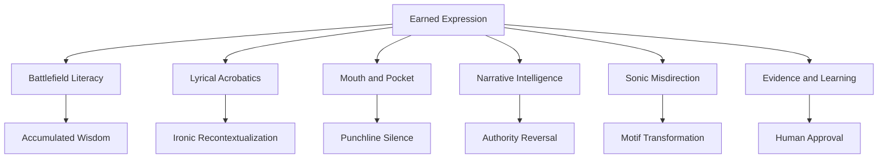

# Outlands Songcraft Skill Tree v0.1

Status: PROPOSED skill curriculum, no released or canonical album modifications and no audio analysis.

## Six-branch map

The tree data in skills.json specifies all 26 skills, tier, real prerequisites, bounded exercise and required evidence. Skill seed status does not claim achieved artistic competency. Progression: SEED → PRACTICED → LISTENING_VALIDATED → HUMAN_APPROVED. Listening-validated requires actual supplied/heard audio. Human approval is track-scoped and never automatic.

## Cross-branch combos
- **Concede-for squad wipe:** LX03 + LX05 + MP05 + NI03. Preserve assistant-written "What the other team can see for." independently from human-heard "What did the other team concede for?". User's intended joke: coach surveys height/fight/detour, finds opposition already eliminated; nobody literally surrendered. Silence after the question can stage recognition, pending listening.
- **Earned swagger:** BF02 + BF03 + LX01 + NI04. Tactical constraint leads to costly choice, changed behavior, and squadmate's earned agency instead of narrator boasting without history.
- **Metaphor grammar:** LX02 + MP04. Grammar-field terms (fluent, literate, punctuation) have causal roles. Gemini's AABB critique is a hypothesis rather than strict law; rhyme neatness must not force meaningless syntax.
- **Two taps / blue ping:** BF04 + LX04 + SN04. Tiny early details recur later as new decisions and musical cues, turning memory into composition.
- **Moist production:** SN01–SN04. Warm low-tenor, Dirty South lurch, crisp ad-libs, swampy synth reply, stop-start 808; purposeful song-specific differences and narrative-driven drops.
- **Heard Differently:** LX03 + EL02 + EL03. Record exact original and human-heard phonetics separately. A surprise reading may deserve its own reversible branch.

## Album workflow
1. Select one track in track-development-matrix.json.
2. Inspect two focal skills and prerequisites with the CLI.
3. Define mode, POV, trio, POI, guns, ammo, heals, ordnance, armor, abilities, ring, escape route; verify any season-sensitive rules.
4. Choose 1–3 details that cause decisions, and write a consequential scene. Don't inventory-dump lyrics.
5. Workshop semantic effect, character distinctions, stresses, pauses and pocket. A full-song request means a real song, not two repeated test bars.
6. Let Moist propose sonically distinct treatments; generate real audio via a supported platform separately.
7. Compare actual takes, record listener mishearings, preserve candidates and obtain explicit human approval.

## Run the read-only tools
From repository root:
- python3 projects/no-free-reads/skill-tree/skilltree_cli.py branches
- python3 projects/no-free-reads/skill-tree/skilltree_cli.py track 06
- python3 projects/no-free-reads/skill-tree/skilltree_cli.py skill LX05
- python3 projects/no-free-reads/skill-tree/skilltree_cli.py validate
- python3 -m unittest discover -s projects/no-free-reads/skill-tree/tests -v

Evidence record: learning-ledger.json. Production calibration: calibration-workbook.md. This pilot is not automatically registered with Harness² or Suno.
